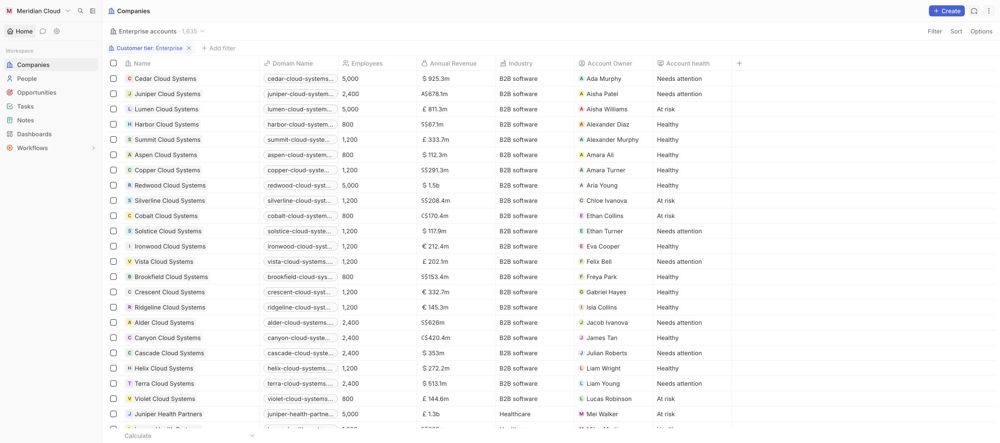
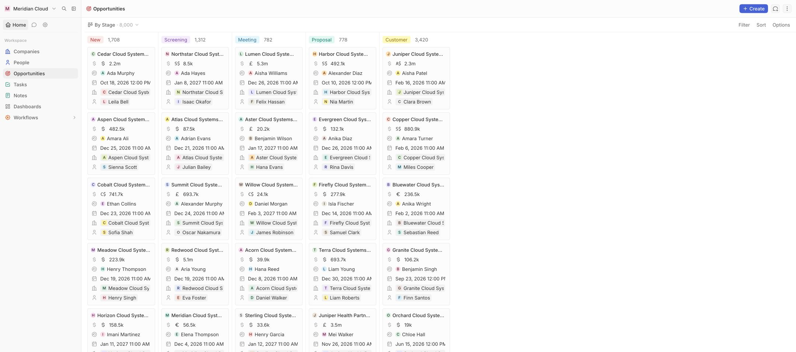

# Twenty Materic demo product

This fork hosts **Meridian Cloud**, a fictional software company using Twenty as its CRM. It is a separate test product with no Materic connection.

- Application: https://twenty-materic-demo-product.materic.inc
- GCP project: `twenty-stuard-demo-product` (display name `twenty-materic-demo-product`), under Materic. GCP project IDs and resource names are permanent, so they, the Compose project and the original image package keep the former name.
- Former address https://twenty-stuard-demo-product.materic.inc redirects to the application.
- Deployment branch: `codex/demo-product`
- Upstream: [`twentyhq/twenty`](https://github.com/twentyhq/twenty), initially pinned to `twenty/v2.48.0`

Use the [data guide](data/README.md) for the synthetic accounts, records, dashboards, repeatable imports and validation. The [hosting guide](deploy/README.md) covers persistent storage, HTTPS, backups and baseline recovery. The [delivery guide](ci/README.md) covers source builds, automatic deployment and daily upstream review branches.

Credentials live in Infisical **Apps**, environment **dev**, path `/twenty-materic-demo-product`. The owner email is `alex.morgan@meridian-cloud.example`; retrieve `TWENTY_OWNER_PASSWORD` through scoped runtime injection. `DEMO_SMOKE_EMAIL` and `DEMO_SMOKE_PASSWORD` identify a regular staff account used by deployment checks. Never put passwords or API keys in this repository.

The deployed workspace contains 81 login accounts (one Admin and 80 Members), 5,000 companies, 25,000 contacts, 8,000 opportunities, 24,000 tasks and 20,000 notes. Including their 132,000 activity links, this is 214,000 CRM records. Three native dashboards contain 20 live widgets, and eleven shared operational views expose different portfolios and workflows. All company and staff identities are synthetic. Mail, calendar, payment and AI providers are not connected.

The deployed source release is commit `d98f3b43239b06dd440adb4d0d3d1800a2b2b54b`, delivered by [Actions run 39169256314](https://github.com/materic-inc/twenty-materic-demo-product/actions/runs/39169256314). The pipeline compiles the actual frontend/backend, publishes an immutable image, deploys through GCP's authenticated SSH tunnel, and verifies a regular staff login and CRM navigation in Chromium. Documentation and evidence commits do not trigger another application build. See `demo/evidence/` for persisted data, role, file and recovery verification.

Hosting uses a dedicated GCP VM and persistent disk. The hostname is a subdomain of Materic's existing `materic.inc` registration, managed through Vercel DNS; no additional domain registration was purchased. GCP infrastructure uses the existing billing account.

Application updates preserve the database and uploads. The daily upstream workflow proposes changes on `automation/upstream-main`; it does not deploy them automatically. Review database migrations and preserve the matching recovery snapshot before adopting a new upstream version.

The permanent reset baseline is `twenty-stuard-demo-baseline-20261018`. Its database archive was restored into a temporary database and its company/contact/opportunity counts matched; the temporary database was then removed. The uploads archive contains the same uploaded test document bytes verified over public HTTPS. [The baseline manifest](evidence/baseline-manifest.json) records its matching image, source revision and archive checksums. Follow the hosting guide to restore that matching version in isolation before a deliberate live reset. Nightly disk snapshots retain seven days separately from this named baseline.

## Deployed workspace

